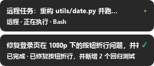
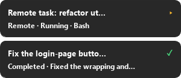

<div align="center">

# 🟡 ZCode Pet

**为 [ZCode](https://z.ai) 打造的任务进度桌宠 —— 让 AI 编程会话在你的桌面上活起来。**

中文 · [English](README.md) · **作者：[@Hai-mian-33](https://github.com/Hai-mian-33)**

`Windows` `Python 3.9+` `PyQt5` `MIT License`


</div>

---

ZCode Pet 是 ZCode「Z」Logo 的拟人化桌宠，会把你的 ZCode 会话**正在做的事实时
演给你看**：提交任务时它开始思考，每一次工具调用都有步数统计，**ZCode 等你确认
权限时它会主动提醒**，任务完成时打 ✓ 庆祝——点一下就能跳回 ZCode 界面。

同时支持**本地会话与 SSH 远程服务器上的会话**（通过反向隧道），多会话并行互不
干扰，界面支持**中英双语**（右键菜单随时切换）。

## ✨ 功能特性

- 🎯 **真实进度，不是玩具**——由 ZCode 官方 hooks 驱动
  （`SessionStart` / `UserPromptSubmit` / `PreToolUse` / `PermissionRequest` /
  `PostToolUse` / `PostToolUseFailure` / `Stop`），同时兼容 `snake_case` 与
  `camelCase` 两种事件字段格式。
- 🃏 **可折叠卡片堆**——每个会话一张卡：任务标题、实时状态、步数、耗时；
  完成的卡片带绿色 ✓ 和结果摘要**常驻显示，点击跳转后才消失**。
- 🐾 **点击直达**——点小宠聚焦 ZCode 窗口；点卡片跳到对应会话。
- 📌 **边缘保护**——宠物永远拖不出桌面；上方没空间时卡片自动翻到小宠下方。
- 🔁 **跟随 ZCode 生命周期**——ZCode 打开时自动出现（钩子拉起器），
  ZCode 进程关闭时桌宠自动退出（内置进程监视）。
- 🖥 **远程友好**——自动维持 SSH 反向隧道（见 `tunnels.txt`），Linux 服务器上
  跑的任务也能实时显示，远程卡片带标注。
- 🌏 **中英双语**——界面随时切换并记住选择。
- 🔇 **桌面零打扰**——详细日志写入 `pet.log`，桌面保持干净。

## 📸 运行截图


*空闲 · 思考中 · 执行中 · 等你确认 · 已完成 ✓*

**任务卡片**常驻在小宠上方——进行中的任务和已完成的任务（绿色 ✓ + 结果摘要）
都会一直显示，直到你点击它跳转 ZCode：

| 中文界面 | English UI |
|---|---|
|  |  |

ZCode 等待权限确认时，卡片 + 系统通知双提醒：

| 小宠状态 | 任务卡片 |
|---|---|
|  |  |

> 以上截图均由 `tools/gen_screenshots.py` 离屏渲染生成，
> 随时可运行 `python tools/gen_screenshots.py` 重新生成。

## 🚀 快速开始（Windows）

```bat
:: ① 安装依赖
pip install PyQt5

:: ② 安装钩子（写入 ~/.zcode/cli/config.json，自动备份）
python setup_hooks.py

:: ③ 启动桌宠（无黑窗口）
scripts\ZCodePet.bat
```

打开 ZCode 随便提交一个任务——桌宠出现并开始实时播报。

### Linux / macOS 服务器（远程任务进度）

```bash
# 在每台服务器上安装钩子（事件经 SSH 反向隧道回传）
python3 setup_hooks_unix.py
```

然后把服务器写进 `tunnels.txt`（从 `tunnels.txt.example` 复制）——桌宠会自动为
每台服务器维持一条 `ssh -N -R 8765` 反向隧道。

## ⚙️ 工作原理

```
ZCode 会话 ──hooks──▶ curl POST 127.0.0.1:8765/event ──▶ ZCode 桌宠
                              │
        远程服务器 ──SSH -R 8765──┘  （隧道由桌宠自动维持）
```

1. `setup_hooks.py` 为每个 ZCode 事件注册一条钩子：用 `curl` 把事件 JSON
   POST 到 `127.0.0.1:8765`——桌宠没开时 curl 毫秒级失败，**绝不会阻塞 ZCode**。
2. 一个极轻的「拉起器」钩子（`pet_launcher.py`）在 ZCode 启动而桌宠未运行时
   自动静默拉起桌宠。
3. ZCode 进程关闭后，桌宠内置监视器会发现并优雅退出。

## 🧩 仓库结构

```
ZCode-pet/
├── zcode_pet.py            # 桌宠本体：事件服务、状态机、渲染
├── pet_launcher.py         # 钩子助手：桌宠未运行时静默拉起
├── setup_hooks.py          # Windows 钩子安装/卸载
├── setup_hooks_unix.py     # Linux/macOS 钩子安装/卸载
├── demo_events.py          # 发送模拟事件做端到端测试
├── autostart.py            # 可选：Windows 登录时自启
├── scripts/                # 双击脚本（.bat）
├── tools/gen_screenshots.py# 离屏重新生成 README 截图
├── tunnels.txt.example     # 远程 SSH 服务器配置模板
├── docs/                   # 截图 + 中英双语文档
├── README.md / README.zh-CN.md
└── LICENSE
```

## 🌏 语言

右键小宠 → **Language / 语言** → 中文 / English，选择会被记住。
也可以设置环境变量 `PET_LANG=zh|en`。

## 🛠 配置

| 文件 / 开关 | 用途 |
|---|---|
| `tunnels.txt` | 每行一条 `user@host[:port]`，桌宠为每台服务器维持 SSH 反向隧道（从 `tunnels.txt.example` 复制） |
| `PET_LANG=zh\|en` | 界面语言（默认跟随系统语言） |
| `scripts/setup_autostart.bat` | 可选：Windows 登录时自启（默认关闭——桌宠跟随 ZCode 生命周期） |
| 右键菜单 | 折叠/展开卡片、隐藏卡片、演示任务、重置位置、语言、退出 |

## ❓ 常见问题

- **会阻塞或拖慢 ZCode 吗？** 不会。钩子只是毫秒级 `curl`；桌宠没开时瞬间
  失败且静默。
- **怎么卸载？** `python setup_hooks.py --remove`（连拉起器一起移除），
  再从托盘菜单退出桌宠。
- **钩子触发了但没反应？** 查 `pet.log`——所有原始事件、隧道状态都在那里。
- **隐私？** 全部本地运行。唯一网络流量是发往 `127.0.0.1` 的 curl 和你自己
  配置的 SSH 隧道。

## 👤 作者

**孙海铭 (Sun Haiming)** — [@Hai-mian-33](https://github.com/Hai-mian-33) · haiming.sun33@gmail.com

开发者：孙海铭，欢迎提 Issue 和 PR！

## 📄 许可证

[MIT](LICENSE)
